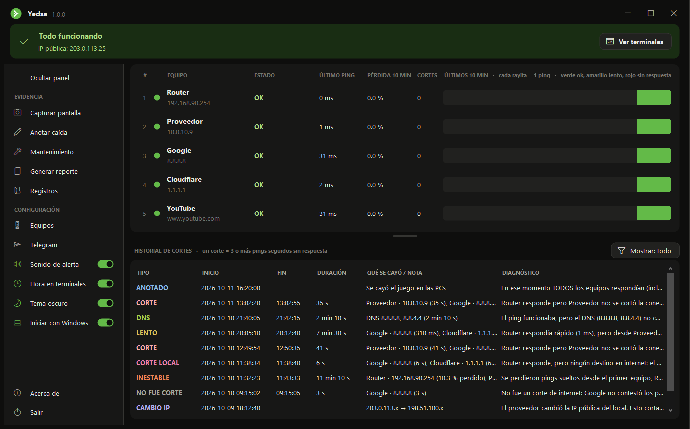
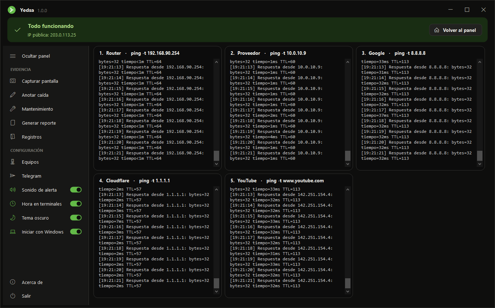

<p align="center">
  
</p>

<h1 align="center">Yedsa</h1>

<p align="center">Encuentra <b>dónde</b> se corta el internet de tu local y junta las pruebas para el proveedor.</p>

<p align="center">
  
</p>

## ¿Qué hace?

Yedsa le hace **ping cada segundo** a cada equipo del camino hacia internet (servidor, switch, routers, Google...) y, cuando algo falla, te dice **cuál fue el primero en dejar de responder**. Así sabes si el problema está en tu red o en el proveedor.

- **Detecta cortes** (3 pings seguidos sin respuesta), mide cuánto duran, da un diagnóstico y dice **de quién es**: del local o del proveedor.
- **Modo mantenimiento**: antes de configurar los routers, lo activas y lo que pase no cuenta como corte ni se manda al proveedor. Se apaga solo.
- **No queda mal configurado sin que nadie se dé cuenta**: anota los ratos en que no vigiló (PC apagada, suspendida, sin luz), avisa si cambia el camino hacia internet o si un equipo lleva mucho sin responder, y al guardar la lista prueba que todos respondan.
- **Avisa cuando falla el DNS** (el ping funciona pero las páginas no cargan) y cuando **internet está lento**, diciendo si la lentitud empieza en tu red o en la del proveedor.
- **Avisa cuando la red está inestable**: si se pierden pings sueltos sin llegar a cortarse (lo que en los juegos se nota como lag), lo anota como **INESTABLE** con cuánto duró y dónde empezó.
- **Terminales `ping -t` reales** dentro del programa, listas para tomar captura.
- **Guarda todo solo**: un registro por día, un bloc de notas por IP y el historial de cortes. Conserva los últimos 7 días (hasta 1 GB) y lo más viejo se borra solo. Si en un día hay más de un millón de pings (muchos equipos), el Excel del día sigue en una "parte 2", porque Excel no abre más filas.
- **Cuida la hora**: cada minuto compara la hora de la PC con la de internet. Si la PC tiene la hora mal, avisa y anota todo con la hora de internet, para que tus pruebas no pierdan valor.
- **Clic en cualquier corte del historial** para ver su detalle completo y copiarlo. Cada equipo queda anotado con su nombre **y su IP** de ese momento, así que si después le cambias la IP, el historial no se confunde. Con el botón **Mostrar** ocultas lo que no quieras ver en pantalla (por ejemplo, la red inestable).
- **Reporte** en HTML: **para el proveedor** (solo lo que le sirve como prueba) o **completo** (todo, para revisar tu red).
- **Avisos por Telegram** cuando hay un corte o cambia la IP pública (gratis).
- **Detecta cambios de IP pública**, que cortan las partidas online aunque el ping se vea bien.
- Tema **oscuro** y **claro**, panel lateral plegable, sigue vigilando junto al reloj y puede iniciar con Windows.

<p align="center">
  
</p>

## Descargar y usar

1. Descarga `Yedsa.exe` desde [Releases](../../releases) (o compílalo, ver abajo).
2. Ponlo en una carpeta propia, por ejemplo `Documentos\Yedsa`, y ábrelo.
3. La primera vez detecta tu router y agrega Google y Cloudflare. Entra a **Equipos** y arma tu lista **en orden**, desde tu PC hacia internet.

Requisitos: Windows 10 u 11. No hace falta instalar nada (usa .NET Framework 4, que ya viene con Windows).

Windows puede mostrar "Windows protegió su PC" la primera vez, porque el programa no tiene firma digital. Se abre con **Más información → Ejecutar de todas formas**.

## Configurar tus equipos

En **Equipos** pones los equipos que quieres vigilar, **en orden, como va el internet**: el primero es el más cercano a tu PC y al final van 2 o 3 **destinos en internet**. Ejemplo:

| # | Nombre | IP | Qué es | Mensaje (opcional) |
|---|---|---|---|---|
| 1 | PC Servidor | 192.168.1.10 | PC o servidor (se apaga) | |
| 2 | Router | 192.168.1.1 | Equipo de mi red | |
| 3 | Impresora | 192.168.1.50 | Fuera del camino | |
| 4 | Proveedor | 10.0.0.1 | Equipo del proveedor | |
| 5 | Google | 8.8.8.8 | Destino en internet | |
| 6 | Cloudflare | 1.1.1.1 | Destino en internet | |

El enlace **¿Cómo armo mi lista?** de la ventana Equipos explica qué poner y en qué orden. Al hacer clic en cualquier columna, abajo aparece qué significa.

**¿Qué es cada equipo?** Decide cómo lo trata Yedsa cuando deja de responder y **de quién es el corte**:

| Qué es | Ejemplo | Si deja de responder |
|---|---|---|
| **Equipo de mi red** | routers, MikroTik, switch | Si el corte empieza ahí, es **CORTE LOCAL**: no va en el reporte para el proveedor. |
| **PC o servidor (se apaga)** | una PC que apagas al cerrar | Apagarse no es corte (ver abajo). |
| **Fuera del camino** | otra red, una impresora | El internet no pasa por él: se avisa y se anota cuánto tardó en volver, pero nunca es corte. |
| **Equipo del proveedor** | los saltos del proveedor en el `tracert` | Si el corte empieza ahí, es **CORTE** del proveedor. |
| **Destino en internet** | Google, Cloudflare | Solo es corte si **todos** dejan de responder; ese corte es del proveedor. |

El editor no deja guardar un orden imposible (un equipo tuyo debajo de uno del proveedor, o algo debajo de los destinos en internet) y avisa si hay menos de 2 destinos en internet.

Se pueden vigilar hasta **30 equipos**. En la pantalla principal se ven 6 y el resto con la barra de la tarjeta. El **divisor** entre los equipos y el historial se arrastra para ver más de uno o del otro, y Yedsa recuerda dónde lo dejaste.

**¿De dónde saco las IPs?** Lo más fácil: en **Equipos**, toca **Detectar mi red**. Yedsa hace un `tracert` hacia Google, prueba cuáles equipos del camino contestan ping y arma la lista en orden. Lo que ya tenías conserva su nombre y su mensaje; lo que ya no está en el camino queda como "Fuera del camino". "Qué es" lo adivina por la IP (192.168.x.x = de tu red, lo demás = del proveedor), así que revísalo antes de guardar. Sirve también cuando cambias de proveedor o alguien cambia los routers.

A mano:
- **Tu router:** Yedsa lo detecta solo la primera vez. También aparece como "Puerta de enlace predeterminada" al escribir `ipconfig` en CMD.
- **Los equipos del proveedor:** escribe `tracert -d 8.8.8.8` en CMD (o usa WinMTR). Los primeros saltos después de tu router son del proveedor. Usa los que respondan a `ping`: con **Probar ping**, en la misma ventana de Equipos, lo compruebas.
- **Internet:** Google `8.8.8.8` y Cloudflare `1.1.1.1` sirven para cualquiera. Elige **Destino en internet** en "Qué es".

**¿Por qué 2 o 3 destinos en internet?** Cualquier servidor de internet puede dejar de contestar pings un momento aunque el internet funcione. Con uno solo, eso parecería un corte. Con varios, Yedsa anota **CORTE** solo si **todos** dejan de responder a la vez; si alguno responde, hay internet y anota **NO FUE CORTE**. Conviene que sean de empresas distintas (Google y Cloudflare), para que un problema de una sola empresa no parezca un corte tuyo.

**¿Qué mensaje sale cuando hay un corte?** Yedsa busca el **primer equipo de la lista que dejó de responder** y muestra:
- **Tu mensaje**, si escribiste uno para ese equipo.
- **Si no, un mensaje automático** según lo que elegiste en "Qué es", por ejemplo: *"Router responde pero Proveedor no: se cortó la conexión con el PROVEEDOR (su cable o fibra, su equipo, o Router)."* En la ventana de Equipos lo ves en gris antes de guardar.
- **Si un equipo no responde pero uno de más adelante sí** (u otro destino en internet), avisa que *no fue un corte de internet*: ese equipo solo dejó de contestar el ping un momento, porque el internet tuvo que pasar por él para llegar al siguiente.

**¿Cómo escribo mi propio mensaje?** Tiene dos partes separadas por dos puntos: *lo que se ve* : *qué puede estar fallando*. Pregúntate: *si todos los de arriba responden y este no, ¿qué puede estar fallando?* Casi siempre es **ese equipo** o **lo que lo une con el anterior** (el cable, o el puerto de alguno de los dos). Plantilla:

> [Anterior] responde pero [Este] no: puede estar fallando [Este] o el cable entre [Anterior] y [Este].

Para el primero de la lista no hay anterior: lo que puede fallar es tu propia PC (su cable o tarjeta de red) o el switch. La misma ayuda está en el enlace **¿Cómo escribo un buen mensaje?** de la ventana Equipos.

**PC o servidor (se apaga):** para equipos que se apagan a propósito, como una PC que apagas al cerrar. Si deja de responder y los demás siguen respondiendo, no se registra como corte de internet:
- Los primeros 10 minutos se muestra **SIN RESPUESTA** (amarillo). Si vuelve en ese tiempo, no se apagó, falló: queda anotado en el historial como **SIN RESPUESTA**, con cuánto duró.
- Pasados 10 minutos se asume que lo apagaste: se muestra **APAGADO** (gris) y no se anota nada.

## Modo mantenimiento

Antes de tocar los routers, los MikroTik o los cables, toca **Mantenimiento** en el panel y elige cuánto vas a tardar (15 min a 2 horas). Mientras dure:

- Lo que pase (cortes, cambios de IP, red inestable) se anota como **MANTENIMIENTO**: no cuenta para el proveedor, no suena y no se avisa por Telegram. Por Telegram solo se avisa que empezó y que terminó.
- Arriba se ve la franja de mantenimiento con la hora de fin.
- **Se apaga solo** a la hora elegida, para que un olvido no esconda cortes de verdad. Se puede terminar antes o pedir 30 minutos más.

¿Te olvidaste de activarlo? **Clic derecho** en la fila del historial → **Fue mantenimiento**. Se puede deshacer de la misma forma.

Más detalle en [Diagnóstico](docs/03-diagnostico.md). Para los avisos al celular, ver [Telegram](docs/06-telegram.md).

## Compilar desde el código

Doble clic en `compilar.bat`. Usa el compilador de C# que trae Windows y deja el programa en `programa\Yedsa.exe`.

## Estructura del proyecto

```
Yedsa/
├── compilar.bat              crea programa\Yedsa.exe
├── src/                      código fuente (C#, Windows Forms)
│   ├── Programa.cs           punto de entrada
│   ├── Modelos.cs            datos: equipo, corte, terminal
│   ├── Configuracion.cs      equipos.txt y ajustes.txt
│   ├── Sistema.cs            internet (HTTPS) y procesos ping.exe
│   ├── Telegram.cs           avisos al celular
│   ├── Ventanas/             ventana principal (repartida por tema) y ventanitas
│   └── Interfaz/             tema de colores, controles, panel lateral, ventana sin borde y logo
├── recursos/                 logo (SVG) e ícono del programa
├── herramientas/             generar-icono.ps1 (solo si cambia el logo)
├── docs/                     cómo funciona: pseudocódigo, diagramas de flujo y código
└── programa/                 se crea al compilar; no se sube al repositorio
```

## Cómo funciona (documentación)

Cada parte está explicada con **pseudocódigo**, **diagrama de flujo** y **código**:

1. [Cómo funciona Yedsa](docs/01-como-funciona.md)
2. [Detección de cortes](docs/02-deteccion-de-cortes.md)
3. [Diagnóstico: ¿dónde está el problema?](docs/03-diagnostico.md)
4. [Registros: qué se guarda y dónde](docs/04-registros.md)
5. [IP pública](docs/05-ip-publica.md)
6. [Avisos por Telegram](docs/06-telegram.md)
7. [Interfaz, colores y logo](docs/07-interfaz-y-colores.md)

## Archivos que crea al usarse

Junto a `Yedsa.exe` aparecen `equipos.txt`, `ajustes.txt` y la carpeta `registros/` (adentro, un `LEEME.txt` explica qué hay y qué se borra solo). Son **datos de cada persona**: no se suben al repositorio (están en `.gitignore`). `ajustes.txt` guarda el código de tu bot de Telegram, así que **no lo compartas**.

## Privacidad

Yedsa no envía tus datos a ningún servidor propio: todo se guarda en tu PC, junto al programa. Solo se conecta a internet para hacer ping a tus equipos, consultar tu IP pública (api.ipify.org, icanhazip.com y checkip.amazonaws.com) y, si lo activas, mandarte avisos por Telegram.

Todo lo que guarda tiene un límite y lo más viejo se borra solo (ver [Registros](docs/04-registros.md)), así que puede quedar encendido años sin llenar el disco.

## Dudas, problemas o ideas

Abre un [Issue](../../issues) en este repositorio y lo reviso.

## Licencia

[MIT](LICENSE): puedes usarlo, modificarlo y compartirlo, manteniendo el aviso de autoría.

El nombre Yedsa es un homenaje a la persona que encargó este proyecto.
