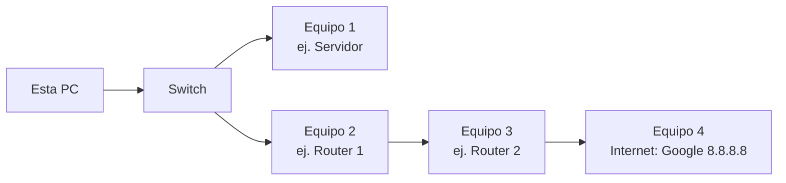
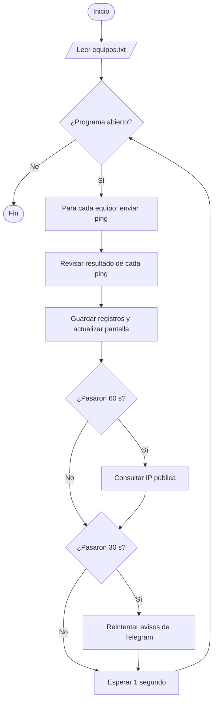

# 1. Cómo funciona Yedsa

## El problema

En un local con muchas PCs (por ejemplo, un LAN center), el internet se corta por momentos: los juegos se caen y vuelven al minuto. El proveedor pide **pruebas** de que el problema es de ellos, pero el corte podría estar en cualquier punto del camino: el cable de una PC, el switch, uno de los routers o el proveedor.

## La idea: revisar la cadena de equipos

Para llegar a internet, cada PC pasa por varios equipos, uno detrás de otro. Yedsa le hace **ping a cada equipo de la cadena, cada segundo**, y cuando algo falla mira **cuál fue el primero que dejó de responder**. Ahí empieza el problema.



| Responde... | No responde... | El problema está en... |
|---|---|---|
| — | El primero (y todos los demás) | El cable de esta PC, el switch o ese equipo |
| Hasta el equipo N | Del equipo N+1 en adelante | El equipo N+1 o la conexión entre N y N+1 |
| Todos menos internet | Solo internet | El proveedor |
| Uno de más adelante | Uno de más atrás | No hubo corte: ese equipo solo no contestó el ping |

## El ciclo de cada segundo

### Pseudocódigo

```
Algoritmo Yedsa
    Leer equipos                       // de equipos.txt, en orden desde esta PC hacia internet
    Mientras el programa esté abierto Hacer
        Para cada equipo en equipos Hacer
            Si no hay un ping en curso a equipo Entonces
                Enviar ping a equipo.ip, esperando como máximo 1 segundo
                RevisarResultado(equipo, respondio, ms)       // ver 2-deteccion-de-cortes.md
            FinSi
        FinPara
        Guardar en disco lo pendiente
        Actualizar la pantalla
        Si pasaron 60 segundos Entonces ConsultarIpPublica()   // ver 5-ip-publica.md
        Si pasaron 30 segundos Entonces ReintentarAvisos()     // ver 6-telegram.md
        Esperar 1 segundo
    FinMientras
FinAlgoritmo
```

### Diagrama de flujo



### Código

Un `Timer` de Windows Forms llama a `Tick()` cada 1000 ms (`src/Ventanas/VentanaPrincipal.Monitoreo.cs`):

```csharp
void Tick()
{
    foreach (var e in equipos)
        if (!e.EnCurso) HacerPing(e);       // el ping es asíncrono: la ventana no se congela
    // ... guarda los archivos pendientes ...
    IntentarGuardar();
    ActualizarEstado();                     // franja verde / roja
    ActualizarTitulos();                    // títulos de las terminales
    panel.Invalidate();                     // redibuja la tarjeta de equipos

    DateTime ahora = DateTime.Now;
    if (ahora >= proximaConsultaIp)
    {
        proximaConsultaIp = ahora.AddSeconds(60);
        ConsultarIpPublica();
    }
    if (ahora >= proximoReintentoTelegram)
    {
        proximoReintentoTelegram = ahora.AddSeconds(30);
        Telegram.Procesar();
    }
}
```

`HacerPing` usa `Ping.SendPingAsync` y, cuando llega la respuesta, llama a `Resultado`:

```csharp
async void HacerPing(Equipo e)
{
    e.EnCurso = true;
    DateTime cuando = DateTime.Now;
    bool ok = false;
    long ms = -1;
    try
    {
        using (var p = new Ping())
        {
            PingReply r = await p.SendPingAsync(e.Ip, TIMEOUT);
            if (r.Status == IPStatus.Success) { ok = true; ms = r.RoundtripTime; }
        }
    }
    catch { }
    e.EnCurso = false;
    if (!cerrando) Resultado(e, cuando, ok, ms);
}
```

## Mapa del código

| Archivo | Qué hace |
|---|---|
| `src/Programa.cs` | Punto de entrada. Abre una sola copia del programa y aplica el tema. |
| `src/Modelos.cs` | Datos: `Equipo`, `Incidente` (un corte) y `Terminal`. |
| `src/Configuracion.cs` | Lee y guarda `equipos.txt` y `ajustes.txt`. |
| `src/Sistema.cs` | Cliente HTTPS compartido y el "Job" que cierra los `ping.exe` al salir. |
| `src/Telegram.cs` | Avisos al celular. |
| `src/Ventanas/VentanaPrincipal.cs` | Arma la pantalla, el panel lateral, el ícono junto al reloj y el cierre. |
| `src/Ventanas/VentanaPrincipal.Monitoreo.cs` | Ping, detección de cortes y diagnóstico. |
| `src/Ventanas/VentanaPrincipal.IpPublica.cs` | Cambios de IP pública. |
| `src/Ventanas/VentanaPrincipal.Terminales.cs` | Terminales con `ping -t` reales y captura de pantalla. |
| `src/Ventanas/VentanaPrincipal.Registros.cs` | Archivos por día, historial, notas y reporte. |
| `src/Ventanas/VentanaPrincipal.Mantenimiento.cs` | Modo mantenimiento y marcar filas del historial como mantenimiento. |
| `src/Ventanas/VentanaPrincipal.Vigilancia.cs` | Ratos sin vigilar, cambios de camino y equipos que llevan mucho sin responder. |
| `src/Ventanas/VentanaPrincipal.Calidad.cs` | Fallas de DNS e internet lento. |
| `src/Ventanas/VentanaPrincipal.Hora.cs` | Revisa si la PC tiene la hora mal y la corrige con la de internet. |
| `src/Ventanas/VentanaPrincipal.Dibujo.cs` | Dibujo de la tarjeta de equipos. |
| `src/Ventanas/EditorEquipos.cs`, `VentanaTelegram.cs`, `Dialogos.cs` | Ventanitas. |
| `src/Interfaz/*` | Tema de colores, controles redondeados, panel lateral, ventana sin borde y logo. |

`VentanaPrincipal` es una sola clase repartida en varios archivos con `partial class`: así cada archivo trata un solo tema.
