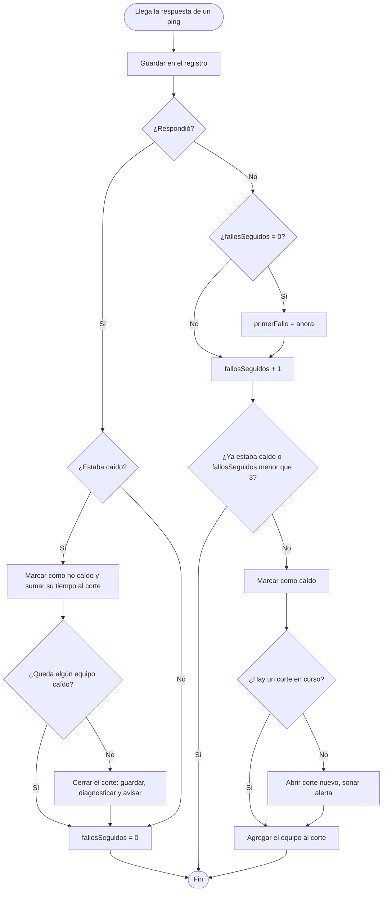

# 2. Detección de cortes

## Qué resuelve

Perder **un** ping suelto es normal: un router ocupado a veces no contesta. Un **corte** es otra cosa: varios pings seguidos sin respuesta. Yedsa considera que un equipo está caído cuando falla **3 pings seguidos** (unos 3 segundos), y que el corte termina cuando **todos** los equipos vuelven a responder.

| Dato | Significado |
|---|---|
| `UMBRAL = 3` | Pings seguidos sin respuesta para declarar caído un equipo |
| `FallosSeguidos` | Contador de fallos seguidos del equipo |
| `PrimerFallo` | Hora del primer fallo de la racha: es la hora real en que empezó el corte |
| `actual` | El corte (incidente) en curso, o nada si todo está bien |

## Pseudocódigo

```
Funcion RevisarResultado(equipo, respondio, ms)
    Guardar el ping en todos_los_pings.csv
    Si respondio Entonces
        Si equipo.caido Entonces
            equipo.caido <- Falso
            Sumar al corte actual el tiempo que estuvo caído
            Si ningún equipo está caído Entonces
                CerrarCorte()                       // guarda el corte, avisa y diagnostica
            FinSi
        FinSi
        equipo.fallosSeguidos <- 0
    SiNo
        Si equipo.fallosSeguidos = 0 Entonces
            equipo.primerFallo <- ahora
        FinSi
        equipo.fallosSeguidos <- equipo.fallosSeguidos + 1
        Si NO equipo.caido Y equipo.fallosSeguidos >= UMBRAL Entonces
            equipo.caido <- Verdadero
            Si no hay corte actual Entonces
                actual <- nuevo corte que empieza en equipo.primerFallo
                Sonar alerta y mostrar aviso
            FinSi
            Agregar equipo a los caídos del corte actual
        FinSi
    FinSi
FinFuncion
```

## Diagrama de flujo



## Código

`src/Ventanas/VentanaPrincipal.Monitoreo.cs`:

```csharp
void Resultado(Equipo e, DateTime cuando, bool ok, long ms)
{
    e.Enviados++;
    if (ok) e.UltimoMs = ms; else e.Perdidos++;
    e.Historial.Add(!ok ? Muestra.Perdido : ms > LENTO ? Muestra.Lento : Muestra.Ok);
    if (e.Historial.Count > HIST) e.Historial.RemoveAt(0);
    EscribirPing(cuando, e, ok, ms);

    if (ok)
    {
        if (e.Caido)
        {
            e.Caido = false;
            if (actual != null)
            {
                Sumar(actual, e, (cuando - e.PrimerFallo).TotalSeconds);
                if (!equipos.Any(x => x.Caido)) CerrarIncidente(cuando, "");
            }
        }
        e.FallosSeguidos = 0;
        return;
    }

    if (e.FallosSeguidos == 0) e.PrimerFallo = cuando;
    e.FallosSeguidos++;
    if (e.Caido || e.FallosSeguidos < UMBRAL) return;

    e.Caido = true;
    e.Cortes++;
    if (actual == null)
    {
        actual = new Incidente();
        actual.Inicio = e.PrimerFallo;
        actual.Caidos.Add(e);
        // ... ícono rojo, sonido y aviso junto al reloj ...
    }
    else
    {
        actual.Caidos.Add(e);
        if (e.PrimerFallo < actual.Inicio) actual.Inicio = e.PrimerFallo;
    }
}
```

## Correspondencia

| Pseudocódigo | Código |
|---|---|
| `respondio` | `ok` |
| `equipo.caido` | `e.Caido` |
| `equipo.fallosSeguidos` | `e.FallosSeguidos` |
| `equipo.primerFallo` | `e.PrimerFallo` |
| `UMBRAL` | `const int UMBRAL = 3` |
| `CerrarCorte()` | `CerrarIncidente(cuando, "")` |

## Equipos que pueden estar apagados

Algunos equipos se apagan a propósito, por ejemplo una PC que se apaga al cerrar el local. En **Equipos**, en "Qué es", se elige **PC o servidor (se apaga)**. Si uno de ellos deja de responder pero **los que están después en la cadena siguen respondiendo**, el internet no se cortó: el equipo solo se apagó. Se muestra en gris como **APAGADO** y **no** se registra como corte (sin historial, sin sonido, sin Telegram). Cuando vuelve a responder, se vigila normal otra vez.

Si en cambio se cae junto con los demás, sí cuenta como parte de un corte.

¿Y si en realidad falló (un cable flojo, un cuelgue)? La diferencia está en **cuánto tiempo estuvo ausente**: apagarlo dura horas; una falla, segundos o pocos minutos. Por eso:

- Los primeros **10 minutos** (`MINUTOS_AUSENCIA`) se muestra **SIN RESPUESTA** en amarillo.
- Si vuelve antes, queda una fila **SIN RESPUESTA** en el historial con cuánto duró (sin Telegram: el internet no se cortó).
- Si pasan los 10 minutos, se muestra **APAGADO** en gris y, cuando vuelva, no se anota nada.

```
Si equipo vuelve a responder Y estaba apagado Entonces
    ausencia <- ahora - equipo.primerFallo
    Si equipo.seApaga Y ausencia < 10 minutos Entonces
        Anotar "SIN RESPUESTA" con la duración      // falló, no lo apagaron
    FinSi
FinSi
```

```
Si equipo.seApaga Y algún equipo después de él está respondiendo Entonces
    equipo.apagado <- Verdadero        // no se abre ningún corte
FinSi
```

```csharp
if (e.SeApaga && equipos.Any(x => x.Indice > e.Indice && !x.Apagado && x.Enviados > 0 && x.FallosSeguidos == 0))
{
    e.Caido = true;
    e.Apagado = true;
    return;
}
```

## Equipos apagados sin marcar

Un corte termina cuando **todos** los equipos responden. Si uno queda apagado (por ejemplo, una PC que se apagó a propósito), el corte quedaría abierto para siempre y los cortes nuevos se mezclarían con él. Por eso, si un equipo lleva **más de 5 minutos** sin responder mientras los de después sí responden (`MINUTOS_APAGADO`), el corte se cierra y ese equipo queda como **apagado**: se ve en gris y no cuenta para los cortes hasta que vuelva a responder.

```
Si hay corte actual Y es una contradicción Y dura 5 minutos o más Entonces
    CerrarCorte("se considera apagado")
    Marcar como apagados a los equipos de ese corte
FinSi
```

## Red inestable

Un ping perdido suelto pasa a cada rato en cualquier red y no es un corte. Pero si se pierden **muchos pings sueltos en poco tiempo** (1 o 2 seguidos, nunca 3), los jugadores lo notan como lag o tirones aunque el internet "no se corte". Eso se anota como una fila **INESTABLE** (naranja) en el historial.

- Cada equipo guarda sus pings del **último minuto** que no son parte de un corte (`Recientes`).
- Si algún equipo pierde **5 o más** en ese minuto (`PERDIDAS_INESTABLE`), empieza un rato inestable. Mientras dura, la franja dice "Funcionando, pero la red está inestable desde las...".
- Cuando pasa **1 minuto** sin que ningún equipo llegue a eso (`SEGUNDOS_ESTABLE`), se cierra y se anota: desde el primer ping perdido hasta el último, el % que perdió cada equipo (los que perdieron al menos el 2 %) y dónde empezó.
- No se manda por Telegram ni suena: no es un corte.

El diagnóstico usa la misma idea de la cadena que los cortes:

| Qué pasó | Diagnóstico |
|---|---|
| Algún destino en internet respondía bien | Solo un equipo del medio dejó de contestar algunos pings: el internet no se vio afectado. |
| Perdía desde el primer equipo | Puede ser esta PC (su cable o tarjeta de red), el switch o ese equipo. |
| `A` respondía bien y desde `B` en adelante se perdían | La conexión entre `A` y `B` estuvo inestable (el cable, un puerto o `B` muy ocupado). |

```
Cada segundo:
    Quitar de cada equipo los pings de hace más de 1 minuto
    Si algún equipo perdió 5 o más en ese minuto Entonces
        Si no hay un rato inestable Entonces
            Empezar uno desde el primer ping perdido de ese minuto
        FinSi
        rato.ultimaVez <- ahora
    SiNo Si hay un rato inestable Y ahora - rato.ultimaVez >= 1 minuto Entonces
        Anotar "INESTABLE" con la duración, el % de cada equipo y el diagnóstico
    FinSi
```

```csharp
if (equipos.Any(x => !x.Apagado && x.PerdidosRecientes >= PERDIDAS_INESTABLE))
{
    if (inestable == null) { /* empieza en el primer ping perdido del último minuto */ }
    inestable.UltimaVez = ahora;
}
else if (inestable != null && (ahora - inestable.UltimaVez).TotalSeconds >= SEGUNDOS_ESTABLE)
    CerrarInestabilidad();
```

## Columna PÉRDIDA

La columna **PÉRDIDA 10 MIN** del panel muestra el % de pings perdidos en los **mismos 10 minutos** de la línea de tiempo, no desde que se abrió el programa. Así sube si la red está mal **ahora**: en amarillo desde el 2 % y en rojo desde el 10 % (recién abierto el programa no se colorea hasta tener 1 minuto de pings, porque con pocos pings uno solo perdido pesa mucho).

## Equipos fuera del camino

Algunos equipos se quieren vigilar aunque el internet no pase por ellos: otra red, una impresora... En "Qué es" se elige **Fuera del camino**. Si deja de responder:

- Se muestra **SIN RESPUESTA** en el panel y la franja, y sale un aviso junto al reloj.
- **Nunca** entra en un corte: no abre uno, no es parte de uno y no prueba nada sobre los demás (si responde, no significa que el internet pase).
- Cuando vuelve, se anota una fila **SIN RESPUESTA** con cuánto tardó. Si en ese rato hubo un corte de la red, no se anota aparte: cayó por el corte.
- No se marca como apagado: se sigue avisando hasta que vuelva.

```csharp
if (e.EsFuera)
{
    e.Caido = true;   // no se suma a ningún corte
    return;
}
```

## Falla de DNS

El DNS es el que traduce nombres (`www.google.com`, el servidor de un juego) a IPs. Si falla, **el ping funciona pero las páginas no cargan**: para los clientes es como un corte, y Yedsa no lo vería solo con pings.

- Cada 10 segundos (`SEGUNDOS_DNS`) se le pregunta por `www.google.com` a los DNS que usa esta PC (los de la tarjeta que sale a internet). La pregunta se manda **directo al DNS** (UDP, puerto 53), no a Windows: Windows guarda las respuestas un rato y seguiría contestando aunque el DNS esté caído.
- Si **ninguno** contesta 3 veces seguidas (`FALLOS_DNS`) **mientras el internet funciona**, empieza una falla de DNS: suena, avisa junto al reloj y la franja se pone roja (*"Las páginas no cargan: el DNS no responde"*). Sin internet no cuenta: es parte del corte.
- Cuando vuelve a contestar, se anota una fila **DNS** con cuánto duró. Si fue de 1 minuto o más, se avisa por Telegram.
- El diagnóstico dice de quién es el DNS: uno con IP privada es el del router del local; uno de afuera (como `8.8.8.8`) puede fallar por el proveedor o por el propio DNS.

## Internet lento

A veces nada se corta, pero todo tarda tanto que los juegos en línea se traban.

- Cada equipo guarda los milisegundos de sus pings del último minuto (`Latencias`).
- Si **todos** los destinos en internet tienen una mediana de **150 ms o más** (`LENTO`, con al menos 20 pings), empieza un rato de **internet lento**. La franja lo dice. Termina cuando pasa 1 minuto sin estar lento.
- Para saber **dónde empieza** la demora, se mira el promedio de cada equipo del camino durante ese rato: el primero que tardaba 100 ms o más (`MS_EQUIPO_LENTO`; lo normal es 0 a 5 ms).

| Primer equipo lento | Diagnóstico |
|---|---|
| Uno del local | La red del local estaba saturada (alguien descargando mucho) o el router muy cargado. No es del proveedor. |
| Uno del proveedor | La red del proveedor estaba saturada o con problemas. |
| Ninguno (solo internet) | Problema en la salida a internet del proveedor. |

Se probó con una copia de Yedsa usando como "internet" dos servidores de Asia (~300 ms): anotó **LENTO** con *"Tus equipos y los del proveedor respondían rápido, pero internet iba lento"*.

## Ratos sin vigilar

Si la PC se apaga, se suspende, se va la luz o alguien cierra Yedsa, no hay datos de ese rato. Para que se sepa (por ejemplo, si el proveedor pregunta por esas horas), Yedsa anota la hora cada 30 segundos en `registros\latido.txt`:

- **Al cerrarse bien**, anota además por qué: `cerrado;usuario` (alguien lo cerró) o `cerrado;windows` (Windows lo cerró al apagar o reiniciar).
- **Al abrirse**, si la última hora tiene más de 2 minutos (`MINUTOS_HUECO`), anota una fila **SIN VIGILAR** con el rato y el motivo. Si no dice que se cerró, fue de golpe: se fue la luz, la PC se colgó o se apagó.
- **Mientras corre**, si entre un segundo y el siguiente pasaron más de 30, la PC estuvo **suspendida**: también se anota, y un corte que estaba abierto se cierra a la hora en que se dejó de vigilar.
- Si el rato fue de 10 minutos o más, se avisa por Telegram que Yedsa volvió a vigilar.

**Al volver** (y al arrancar con Windows), la red tarda unos segundos en conectarse. Los pings de los primeros 30 segundos (`SEGUNDOS_GRACIA`) quedan registrados pero no abren cortes; si no, cada encendido parecería un corte.

```
Al abrir:
    ultimo <- hora guardada en latido.txt
    Si ahora - ultimo >= 2 minutos Entonces
        Si latido dice "cerrado;usuario" Entonces motivo <- "Alguien cerró Yedsa"
        SiNo Si dice "cerrado;windows" Entonces motivo <- "Se apagó o reinició la PC"
        SiNo motivo <- "No se cerró normalmente: se fue la luz o la PC se colgó"
        Anotar "SIN VIGILAR" de ultimo a ahora, con el motivo
    FinSi
```

## ¿Cambió el camino?

Si alguien cambia la IP de un MikroTik o el proveedor cambia sus equipos, ese equipo deja de responder mientras el internet sigue pasando: saldría como "no fue corte" y a los 5 minutos quedaría apagado **para siempre**, sin que nadie se dé cuenta. Para evitarlo:

- **Cada 30 minutos** (`MINUTOS_CAMINO`) se hace un `tracert -d` hacia el primer destino en internet, solo de tantos saltos como equipos del local y del proveedor haya en la lista. Más allá del proveedor no se mira: en internet las rutas cambian solas todo el tiempo.
- La primera vez se guarda como **camino conocido** (en `ajustes.txt`). Si se edita la lista de equipos, se empieza de nuevo.
- Si el camino sale distinto, se vuelve a revisar a los 5 minutos: si se repite, se anota **CAMBIO DE CAMINO** con el camino de antes y el de ahora, y qué equipos de la lista ya no aparecen. Avisa junto al reloj y por Telegram.
- Un salto que no respondió (`*`) no cuenta como cambio. Durante un corte o un mantenimiento no se revisa.

## Equipos que llevan mucho sin responder

Si un equipo de la red o del proveedor (o uno fuera del camino) lleva **30 minutos** sin responder (`MINUTOS_AVISO_LARGO`), se avisa **una vez**, junto al reloj y por Telegram: puede que haya cambiado su IP o que ya no conteste pings. Las PC que se apagan no avisan: apagarse es normal. Si el equipo vuelve y se cae otra vez, se vuelve a avisar.

## Detectar mi red

El botón **Detectar mi red** del editor arma la lista con el camino real:

1. `tracert -d` hacia `8.8.8.8` (hasta 15 saltos) y un ping a cada salto: los que no contestan pings no sirven para vigilar y no se agregan.
2. Se toman los saltos **hasta el primero con IP pública** (el borde del proveedor). Más allá ya es internet, donde las rutas cambian solas.
3. "Qué es" se adivina por la IP: hasta el último salto con IP de local (`192.168.x.x` o `172.16-31.x.x`) son **Equipo de mi red**; los siguientes, **Equipo del proveedor**. Si un equipo ya estaba en la lista como de la red o del proveedor, se respeta lo que se eligió.
4. Se arma: primero las PCs que se apagan, luego el camino, luego lo que estaba en la lista y ya no está en el camino (como **Fuera del camino**, con su mensaje borrado porque era para otro lugar de la cadena) y al final los destinos en internet (Google y Cloudflare si no había ninguno).
5. Nada se guarda hasta tocar **Guardar**, y un resumen explica qué cambió y qué revisar.

```
saltos <- tracert hacia 8.8.8.8
ultimo <- primer salto con IP pública
Para cada salto hasta ultimo:
    Si no contesta ping Entonces seguir con el siguiente
    Si ya estaba en la lista Entonces conservar nombre, mensaje y lo que es
    SiNo Si está antes del último 192.168.x.x Entonces "Equipo de mi red"
    SiNo "Equipo del proveedor"
```

## Al guardar la lista

Al tocar **Guardar** en Equipos, se le hace ping a todos a la vez. Si alguno no responde, se muestra cuáles antes de guardar: una IP mal escrita se ve en ese momento y no días después como un equipo "caído".

## Modo mantenimiento

Mientras alguien configura la red, los routers se reinician, cambian las IP... y eso no es culpa del proveedor. El **modo mantenimiento** (opción **Mantenimiento** del panel) dura un tiempo elegido (15, 30, 60 o 120 minutos) y **siempre se apaga solo**: si dependiera de que alguien lo apague, un olvido escondería cortes de verdad.

- Un corte, una red inestable, un equipo sin respuesta o un cambio de IP que pase (aunque sea en parte) durante el mantenimiento se guarda como **MANTENIMIENTO**, con su tipo original entre corchetes: `[CORTE] Proveedor (entrada) (35 s)`.
- No suena, no muestra el globito de corte y no va a Telegram. Por Telegram solo se avisa que empezó y que terminó, para que nadie piense que Yedsa dejó de funcionar.
- Al terminar queda una fila **MANTENIMIENTO** con el rato completo.
- Se guarda en `ajustes.txt` (`mantenimiento_desde`, `mantenimiento_hasta`): si Yedsa se reinicia en medio, sigue; si ya pasó la hora, anota el rato al abrirse.

```
Cada segundo:
    Si hay mantenimiento Y ya pasó la hora de fin Entonces
        Anotar el rato de mantenimiento y terminarlo
    SiNo Si hay mantenimiento Entonces
        Marcar el corte y la red inestable de ahora como "en mantenimiento"
    FinSi

Al cerrar un corte:
    Si el corte estuvo en mantenimiento Entonces
        Guardarlo como MANTENIMIENTO, "[CORTE] ..." (sin sonido ni Telegram)
    FinSi
```

Si se olvidó activarlo, en el historial: **clic derecho → Fue mantenimiento** (y lo mismo para deshacerlo).

Estructuras usadas: **selección** (`if`) para decidir qué pasó, **contador** (`FallosSeguidos`) para la racha de fallos y **repetición** (el `foreach` de `Tick`, cada segundo) para revisar todos los equipos.
