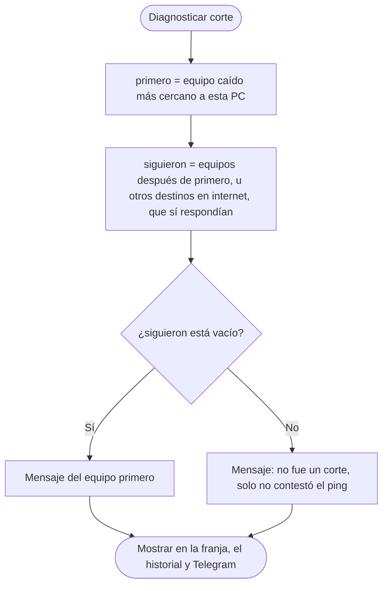

# 3. Diagnóstico: ¿dónde está el problema?

## Qué resuelve

Cuando hay un corte, no basta con saber *que* se cortó: hay que saber **dónde**. Como los equipos están en orden (de esta PC hacia internet), el primero que dejó de responder marca el punto donde empieza el problema.

Hay un caso especial: si un equipo no responde pero **otro que está después en la cadena sí**, no fue un corte. El tráfico tuvo que pasar por ese equipo para llegar al siguiente; simplemente no contestó el ping (pasa cuando un router está ocupado). A eso se le llama **contradicción**.

### Los destinos en internet

Al final de la lista van 2 o 3 **destinos en internet** (por ejemplo Google `8.8.8.8` y Cloudflare `1.1.1.1`), con **Destino en internet** en "Qué es". Estos no van uno detrás de otro: son **caminos paralelos**. Por eso, para un destino en internet, "los que están después" son **los otros destinos**:

- Si Google no responde pero Cloudflare sí, hay internet: **NO FUE CORTE** (Google solo no contestó los pings).
- Solo es **CORTE** de internet si **todos** los destinos dejan de responder a la vez.

Así se tapa un punto ciego: con un solo destino al final, ese destino nunca podía salir como "no fue corte", porque no había nadie después de él. Conviene que sean de **empresas distintas**, para que un problema de una sola empresa no parezca un corte del local. Si en una lista vieja no se marcó ninguno, el último de la lista hace de internet, como antes.

### De quién es el corte

Cuando sí hubo corte, importa **de quién es**, porque el reporte para el proveedor solo debe llevar los suyos. Lo decide el primer equipo que dejó de responder, según lo que se eligió en "Qué es":

| Primer equipo caído | Tipo de fila | ¿Va en el reporte para el proveedor? |
|---|---|---|
| Equipo de mi red o PC | **CORTE LOCAL** | No |
| Equipo del proveedor o destino en internet | **CORTE** | Sí |

```csharp
bool EsDelLocal(Equipo e)
{
    return (e.Rol == Rol.Red || e.Rol == Rol.Pc) && !EsInternet(e);
}
```

**Si la red del local estaba inestable.** Cuando un MikroTik pierde uno de cada cuatro pings, a veces justo se pierden 3 seguidos de Google mientras el MikroTik alcanza a contestar. Yedsa vería que "el primero que cayó fue Google" y culparía al proveedor. Por eso, si un equipo del local que está **antes** del primero caído perdió **3 o más pings** en el último minuto (`PERDIDAS_LOCAL_SOSPECHOSAS`), el corte queda como **CORTE LOCAL** con la nota *"Pasó mientras la red del local estaba inestable (MikroTik 1 venía perdiendo pings)"*.

Se probó con los cortes de varios días de un local: los cortes de verdad del proveedor tenían 0 o 1 ping perdido en los equipos del local en el minuto anterior y siguen siendo del proveedor; los de un rato en que un router del local perdía entre 5 y 21 pings por minuto pasan a ser del local.

```csharp
Equipo LocalInestable(Equipo primero)
{
    return equipos.Where(x => x.Indice < primero.Indice && EsDelLocal(x) && x.PerdidosRecientes >= PERDIDAS_LOCAL_SOSPECHOSAS)
                  .OrderBy(x => x.Indice).FirstOrDefault();
}
```

Los equipos **fuera del camino** no cuentan para nada de esto: el internet no pasa por ellos, así que no abren cortes ni prueban que el internet funcione.

Cada equipo tiene un **mensaje** (se edita en *Equipos*) que se muestra cuando el corte empieza en él. Si está vacío, se arma uno automático según lo que es: para el primer equipo del proveedor dice que se cortó la conexión con el proveedor, para los siguientes que el problema está dentro de su red, y para los destinos en internet que falla la salida a internet del proveedor.

## Cómo escribir un buen mensaje

Tiene dos partes separadas por dos puntos: **lo que se ve** : **qué puede estar fallando**. La pregunta que lo arma es: *si todos los de arriba responden y este no, ¿qué puede estar fallando?* Casi siempre:

1. **Este equipo** (apagado, colgado o dañado).
2. **Lo que lo une con el anterior**: el cable, o el puerto de alguno de los dos.

| Equipo | Mensaje |
|---|---|
| 1. PC Servidor | Ningún equipo responde, ni siquiera el PC Servidor: falla esta PC (su cable o tarjeta de red) o el switch. |
| 2. MikroTik 1 | El PC Servidor responde pero el MikroTik 1 no: puede estar fallando el MikroTik 1 o el cable que va del switch al MikroTik 1. |
| 3. MikroTik 2 | El MikroTik 1 responde pero el MikroTik 2 no: puede estar fallando el MikroTik 2 o el cable entre los dos MikroTik. |
| 4. Proveedor (entrada) | El MikroTik 2 responde pero la entrada del proveedor no: se cortó la conexión con el proveedor. |
| 5. Google, 6. Cloudflare (destinos en internet) | Automático: El Proveedor (entrada) responde, pero ningún destino en internet: el problema está en la salida a internet del PROVEEDOR. |

El mensaje queda guardado en el historial **tal como estaba escrito en ese momento**; si después se cambia, los cortes viejos conservan el texto anterior.

## Pseudocódigo

```
Funcion mensaje <- Diagnosticar(corte)
    primero <- el equipo caído con menor posición en la lista
    siguieron <- Despues(primero) que NO se cayeron
    Si siguieron no está vacío Entonces
        mensaje <- "No fue un corte de internet: " + primero + " no contestó, pero " + siguieron + " sí respondía"
    SiNo
        mensaje <- primero.diagnostico
    FinSi
FinFuncion

Funcion lista <- Despues(equipo)
    Si equipo es destino en internet Entonces
        lista <- los otros destinos en internet      // caminos paralelos
    SiNo
        lista <- equipos con posición mayor que equipo   // la cadena
    FinSi
FinFuncion

Funcion mensaje <- MensajeAutomatico(nombre, anterior, esInternet)
    Si esInternet Entonces
        mensaje <- anterior + " responde, pero ningún destino en internet: problema en la salida a internet del PROVEEDOR"
    SiNo Si anterior = nada Entonces       // es el primero de la lista
        mensaje <- "Ningún equipo responde, ni siquiera " + nombre + ": falla esta PC, el switch o " + nombre
    SiNo
        mensaje <- anterior + " responde pero " + nombre + " no: puede estar fallando " + nombre + " o el cable entre los dos"
    FinSi
FinFuncion
```

## Diagrama de flujo



## Código

`src/Ventanas/VentanaPrincipal.Monitoreo.cs`:

```csharp
// Equipos que, si responden, prueban que el internet pasaba aunque "e" no conteste.
IEnumerable<Equipo> Despues(Equipo e)
{
    return EsInternet(e) ? equipos.Where(x => x != e && EsInternet(x)) : equipos.Where(x => x.Indice > e.Indice);
}

bool EsContradiccion(Incidente inc)
{
    var primero = inc.Caidos.OrderBy(x => x.Indice).First();
    return Despues(primero).Any(x => !inc.Caidos.Contains(x) && !x.Apagado);
}

string Diagnosticar(Incidente inc)
{
    var caidos = inc.Caidos.OrderBy(x => x.Indice).ToList();
    var primero = caidos[0];
    var siguieron = Despues(primero).Where(x => !inc.Caidos.Contains(x) && !x.Apagado).ToList();
    if (siguieron.Count > 0)
    {
        string fallaron = string.Join(", ", caidos.Select(x => x.Nombre));
        return "No fue un corte de internet: " + fallaron + " no contestó los pings, pero " +
               string.Join(", ", siguieron.Select(x => x.Nombre)) +
               (EsInternet(primero) ? " (otro destino en internet)" : " (que está después en la cadena)") + " sí respondía. " +
               "Lo más probable es que " + fallaron + " estuviera ocupado y no contestara, aunque siguió pasando el internet.";
    }
    return primero.Diagnostico;
}
```

El mensaje automático está en `src/Configuracion.cs`. Para un destino en internet, el "anterior" es el último equipo que **no** es de internet:

```csharp
public static string MensajeAuto(string nombre, string anterior, bool esInternet)
{
    if (esInternet)
        return (anterior == null ? "Ningún destino en internet responde" : anterior + " responde, pero ningún destino en internet") +
               ": el problema está en la salida a internet del PROVEEDOR.";
    if (anterior == null)
        return "Ningún equipo responde, ni siquiera " + nombre + ": falla esta PC (su cable o tarjeta de red), el switch o " + nombre + ".";
    return anterior + " responde pero " + nombre + " no: puede estar fallando " + nombre + " o el cable entre " + anterior + " y " + nombre + ".";
}
```

Las contradicciones se guardan en el historial con su propio tipo, **NO FUE CORTE** (en gris), para que no se confundan con los cortes de verdad (en rojo) ni se cuenten como cortes en el reporte. **No** se mandan por Telegram ni suenan, para no llenar el celular de avisos que no son cortes.

```csharp
bool contradiccion = EsContradiccion(inc);
var campos = new[] { contradiccion ? Tipos.NoFueCorte : Tipos.Corte, /* inicio, fin, duración, equipos, diagnóstico */ };
```
