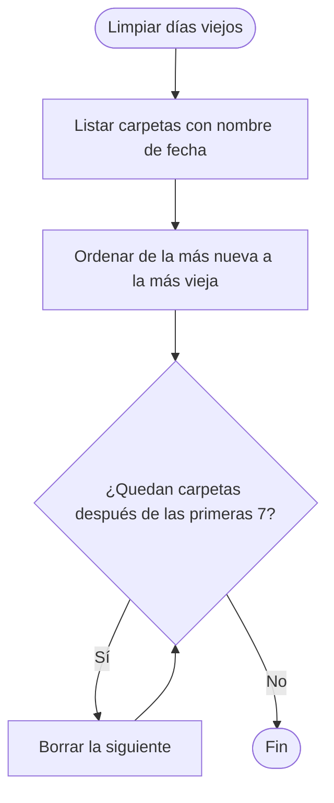

# 4. Registros: qué se guarda y dónde

## Qué resuelve

Para presentarle pruebas al proveedor hace falta un registro con fecha y hora de **cada ping**, de **cada corte** y, si lo piden, la salida de la terminal de **cada IP por separado**. Todo se guarda solo, segundo a segundo, sin botón de guardar: si se va la luz, queda lo registrado hasta ese segundo.

## Archivos

Se crean junto a `Yedsa.exe` (en `programa/` si se compila con `compilar.bat`):

```
registros\
  LEEME.txt                           explica todo esto y qué se borra solo (Yedsa lo crea al abrirse)
  dias\
    2026-10-12\                       una carpeta por día
      todos_los_pings.csv             todos los pings, uno por línea (se abre en Excel)
      todos_los_pings (parte 2).csv   solo si ese día hubo más de un millón de pings (ver abajo)
      Router (192.168.1.1).txt        la terminal "ping -t" de cada equipo, con hora
      Google (8.8.8.8).txt
  incidentes.csv                      historial (ver "Tipos de fila" abajo)
  latido.txt                          la última hora en que Yedsa vigilaba (para saber cuánto rato no vigiló)
  capturas\                           capturas de pantalla
  reportes\                           reportes generados (reporte_AAAA-MM-DD_HHMM.html)
equipos.txt                           la lista de equipos: Nombre;IP;qué es (red, pc, fuera, proveedor
                                      o internet);Mensaje
ajustes.txt                           opciones (tema, sonido, Telegram...). Tiene el código del bot: no compartir.
```

En la pantalla, **un clic en cualquier fila del historial** abre su detalle completo, con el diagnóstico entero y un botón para copiarlo.

Los archivos `.csv` usan `;` como separador y UTF-8 con BOM, para que Excel en español los abra bien.

## Tipos de fila del historial

| Tipo | Color | Qué es |
|---|---|---|
| **CORTE** | rojo | Se cortó el internet y empezó en el proveedor o en internet (ver [Diagnóstico](03-diagnostico.md)). |
| **CORTE LOCAL** | rosado | Se cortó el internet, pero empezó en un equipo del local (un router, un cable, esta PC). |
| **NO FUE CORTE** | gris | Un equipo no contestó, pero otro que está después sí respondía: el internet siguió funcionando. |
| **INESTABLE** | naranja | Se perdieron muchos pings sueltos sin llegar a cortarse (lag). |
| **SIN RESPUESTA** | amarillo | Una PC que se apaga dejó de responder un rato corto y volvió, o volvió un equipo fuera del camino. |
| **CAMBIO IP** | morado | Cambió la IP pública del local. |
| **ANOTADO** | azul | Caída anotada a mano con **Anotar caída**. |
| **SIN VIGILAR** | gris tenue | Rato en que Yedsa no vigiló: PC apagada, suspendida, sin luz, o Yedsa cerrado. Dice por qué. |
| **CAMBIO DE CAMINO** | morado | El camino hacia internet (los equipos del local o del proveedor) cambió. |
| **HORA MAL** | rojo | La hora de la PC estaba mal (o ya se arregló). Desde ahí se usó la hora de internet. |
| **DNS** | verde lima | El ping funcionaba, pero el DNS no contestaba: las páginas no cargaban. |
| **LENTO** | dorado | Todo respondía, pero internet tardaba más de 150 ms: los juegos se traban. Dice dónde empezaba la demora. |
| **MANTENIMIENTO** | celeste | Algo que pasó mientras configuraban la red, o el rato de mantenimiento completo. Lleva el tipo original entre corchetes: `[CORTE] ...`. |

**Clic derecho** en una fila: **Fue mantenimiento** (por si se olvidó activar el modo mantenimiento) o, en una de mantenimiento, **Quitar la marca**. Se cambia la fila en `incidentes.csv`.

Cada equipo se anota con su nombre **y su IP** de ese momento: `Proveedor (entrada) · 10.0.0.1 (35 s)`. Si después se le cambia la IP a un equipo con el mismo nombre, las filas viejas siguen diciendo cuál era. Los avisos de Telegram también llevan la IP.

Los nombres y colores están en un solo lugar, la clase `Tipos` de `src/Modelos.cs`, para que la pantalla, el detalle y el reporte digan lo mismo.

### Mostrar u ocultar tipos en la pantalla

El botón **Mostrar** sobre el historial abre un menú con los 13 tipos. Lo que se desmarca **solo deja de verse en la pantalla**: se sigue guardando en `incidentes.csv` y puede salir en el reporte. La elección se guarda en `ajustes.txt` (`historial_ocultos`).

## El Excel de pings, en partes

Excel abre hasta **1.048.576 filas**, y cada equipo anota una fila por segundo: con 10 equipos un día tiene unas 864.000 filas, pero con 13 o más se pasa (con 30 equipos, 2,6 millones). Para que siempre se pueda abrir, cuando `todos_los_pings.csv` llega a **1 millón de filas** (`MAX_FILAS_CSV`) se sigue en `todos_los_pings (parte 2).csv`, después `(parte 3)`... Cada parte tiene su fila de títulos. Al abrir Yedsa se cuentan las filas de la última parte del día para seguir donde iba.

Lo que se borra solo no cambia: carpetas de más de 7 días, o las más viejas si todo pasa de 1 GB (con 30 equipos se llega a eso en unos 3 o 4 días).

## La hora

Todo lleva hora: las terminales, el Excel de pings, el historial, los reportes, Telegram y hasta el nombre de la carpeta de cada día. Si la PC tiene la hora mal, las pruebas no sirven. Por eso:

- **Se compara cada minuto con la hora de internet.** No hace falta un servicio nuevo: las respuestas de los servicios de IP pública ya traen la hora del servidor (encabezado `Date`), y se toma la del medio de las tres.
- **Si la diferencia pasa de 2 minutos** (`SEGUNDOS_HORA_MAL`): se anota una fila **HORA MAL**, suena, avisa por Telegram y la franja se pone roja con cómo arreglarla. Desde ese momento, `Reloj.Ahora` (la hora que usa Yedsa para todo) es la de la PC **más la diferencia**: lo anotado sale con la hora real aunque nadie arregle el reloj. El reloj de Windows no se toca.
- **La corrección se guarda** (`ajuste_hora_seg` en `ajustes.txt`): al volver a abrir se usa desde el primer segundo, hasta poder comparar otra vez. Si en el medio alguien arregló la hora de la PC, los primeros segundos salen con la corrección vieja y enseguida se quita.
- **Si alguien mueve el reloj de Windows con Yedsa abierto**, el salto se compensa: `Reloj` compara la hora de la PC con el contador de Windows (`GetTickCount64`, que sigue contando aunque la PC se suspenda) y, si no avanzaron igual, descuenta la diferencia. Lo que mide "cada cuánto" (cada minuto la IP, cada 30 minutos el camino, los 30 segundos de gracia...) usa solo ese contador, así que un cambio de hora no lo traba.
- **La zona horaria** no se puede comprobar así (la hora de internet viene en hora universal): el reporte dice arriba la de la PC, por ejemplo *(UTC-05:00) Bogotá, Lima, Quito*.

```
Cada minuto, con la hora que traen los servicios de IP pública:
    diferencia <- hora de internet - hora de la PC
    Si |diferencia| > 2 minutos Entonces
        Reloj.ajuste <- diferencia     // todo se anota con la hora de internet
        Si antes estaba bien Entonces Anotar "HORA MAL" y avisar
    SiNo
        Reloj.ajuste <- 0
    FinSi
```

## Reporte

**Generar reporte** pregunta dos cosas:

1. **Periodo:** hoy, últimos 7 días, últimos 30 días o todo el historial. Así el reporte no crece sin fin aunque el historial tenga años.
2. **Qué incluir**, con dos atajos:
   - **Para el proveedor:** solo lo que le sirve como prueba (los cortes que empezaron en el proveedor, los cambios de IP y las caídas anotadas). Los cortes del local, los avisos que no fueron corte, la red inestable, los equipos sin respuesta y el mantenimiento muestran cosas de la red del local, y al proveedor solo le darían excusas.
   - **Completo (para ti):** todo.

   También se puede marcar cada tipo a mano. Se recuerda lo elegido la última vez (`reporte_periodo` y `reporte_tipos` en `ajustes.txt`).

El reporte dice qué incluye, y el resumen solo cuenta lo incluido; los avisos que no fueron corte **no** se cuentan como cortes. Se guarda en `registros\reportes\reporte_AAAA-MM-DD_HHMM.html` y se abre en el navegador (desde ahí se puede imprimir o guardar como PDF).

## Límites: nada crece para siempre

Yedsa está pensado para quedar encendido años. Todo lo que crece tiene un tope y lo más viejo se borra solo:

| Qué | Límite | Dónde se define |
|---|---|---|
| Carpetas de días en `registros\dias` (pings y bloc de notas por IP) | 7 días **o** 1 GB en total, lo que llegue primero (nunca se borra el día de hoy) | `DIAS_GUARDAR`, `MAX_MB_REGISTROS` |
| Historial de cortes (`incidentes.csv`) | Últimos 10 000 | `MAX_HISTORIAL` |
| Historial en pantalla | Últimos 1000 | `AgregarFila` |
| Capturas de pantalla (`registros\capturas`) | Últimas 100 | `MAX_CAPTURAS` |
| Reportes (`registros\reportes`) | Últimos 30 | `MAX_REPORTES` |
| `errores.txt` | 1 MB | `Programa.cs` |
| Equipos vigilados | 30 | `MAX_EQUIPOS` |
| Líneas visibles en cada terminal | 3000 (se recorta a 1500) | `AgregarLinea` |
| Avisos de Telegram esperando internet | 50 | `Telegram.Avisar` |
| IPs públicas recordadas | 20 | `RegistrarIps` |

Con 6 equipos un día ocupa unos 60 MB; con 30, unos 280 MB. Por eso, además de los días, hay un tope en megas.

## Limpieza automática

Al abrir el programa, y a medianoche si sigue abierto, se borran las carpetas de días que pasen los límites y se recorta el historial.

### Pseudocódigo

```
Funcion LimpiarDiasViejos()
    dias <- carpetas dentro de registros cuyo nombre es una fecha AAAA-MM-DD
    Ordenar dias de la más nueva a la más vieja
    Para i <- DIAS_GUARDAR + 1 Hasta cantidad(dias) Hacer
        Borrar la carpeta dias[i]
    FinPara
FinFuncion
```

### Diagrama de flujo



### Código

`src/Ventanas/VentanaPrincipal.Registros.cs`:

```csharp
void LimpiarDiasViejos()
{
    try
    {
        var dias = Directory.GetDirectories(carpeta).Select(Path.GetFileName)
                            .Where(EsFecha).OrderByDescending(n => n).ToList();
        foreach (var n in dias.Skip(DIAS_GUARDAR))
            try { Directory.Delete(Path.Combine(carpeta, n), true); } catch { }
    }
    catch { }
}
```

Como el nombre de la carpeta es `AAAA-MM-DD`, ordenarlo como texto ya lo ordena por fecha.

## Escritura sin perder datos

- Los archivos se abren con `FileShare.ReadWrite`, así se pueden abrir en Excel o el Bloc de notas mientras el programa sigue escribiendo.
- Si `incidentes.csv` está bloqueado (por ejemplo, abierto en Excel), la línea queda en memoria (`pendientes`) y se vuelve a intentar al segundo siguiente.
- Cada segundo se hace `Flush()`: lo escrito llega al disco aunque el programa se cierre de golpe.
