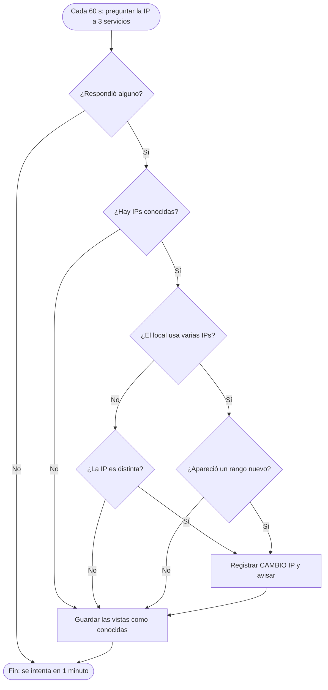

# 5. IP pública

## Qué resuelve

La IP pública es la dirección con la que el local sale a internet (no es la de los routers, que son privadas: `192.168.x.x`). Si el proveedor la cambia, **todas las partidas online se cortan** aunque los ping sigan bien. Detectarlo es una prueba directa.

Hay dos tipos de local:

- **Con una sola IP pública** (lo normal en una casa): si cambia, se avisa.
- **Con varias IPs públicas** (un bloque del proveedor o varias líneas): cada página o servidor sale siempre por la misma, y la IP que se ve "salta" sola entre las del bloque. Avisar cada salto sería una falsa alarma; por eso solo se avisa si aparece una IP de **otro rango** (por ejemplo, de `203.0.113.x` a `198.51.100.x`).

Cada minuto se pregunta a tres servicios gratuitos (`api.ipify.org`, `icanhazip.com`, `checkip.amazonaws.com`) y se recuerdan las IPs vistas en `ajustes.txt`.

## Pseudocódigo

```
Funcion RegistrarIps(vistas)
    conocidas <- Leer "ips_conocidas" de ajustes
    varias <- cantidad(conocidas) > 1 O cantidad(vistas) > 1
    cambio <- Falso
    Si conocidas no está vacío Entonces
        Si NO varias Y vistas[1] <> conocidas[1] Entonces
            cambio <- Verdadero                         // una sola IP y cambió
        SiNo
            Si varias Y alguna IP de vistas tiene un rango que no está en conocidas Entonces
                cambio <- Verdadero                     // el proveedor cambió el bloque
                Vaciar conocidas
            FinSi
        FinSi
    FinSi
    Guardar en "ips_conocidas" las vistas + las conocidas (máximo 20)
    Si cambio Entonces
        Registrar "CAMBIO IP" en el historial, sonar alerta y avisar por Telegram
    FinSi
FinFuncion
```

El **rango** de una IP son sus tres primeros números: el rango de `203.0.113.190` es `203.0.113.x`.

## Diagrama de flujo



## Código

`src/Ventanas/VentanaPrincipal.IpPublica.cs` (resumido):

```csharp
var conocidas = Ajustes.Leer("ips_conocidas").Split(new[] { ',' }, StringSplitOptions.RemoveEmptyEntries).ToList();
bool varias = conocidas.Count > 1 || vistas.Count > 1;
string antes = null, ahoraTxt = null;
if (conocidas.Count > 0)
{
    if (!varias && vistas[0] != conocidas[0])
    {
        antes = conocidas[0];
        ahoraTxt = vistas[0];
    }
    else if (varias)
    {
        var rangos = conocidas.Select(Rango).Distinct().ToList();
        var fuera = vistas.Where(ip => !rangos.Contains(Rango(ip))).ToList();
        if (fuera.Count > 0)
        {
            antes = string.Join(", ", rangos);
            ahoraTxt = string.Join(", ", vistas.Select(Rango).Distinct());
            conocidas.Clear();
        }
    }
}
conocidas = vistas.Concat(conocidas).Distinct().Take(20).ToList();
Ajustes.Poner("ips_conocidas", string.Join(",", conocidas));
if (antes == null) return;
// ... registrar "CAMBIO IP", sonido, aviso junto al reloj y Telegram ...
```

Justo después de cada corte se vuelve a consultar a los 5 segundos, porque los cambios de IP suelen venir pegados a un corte.
