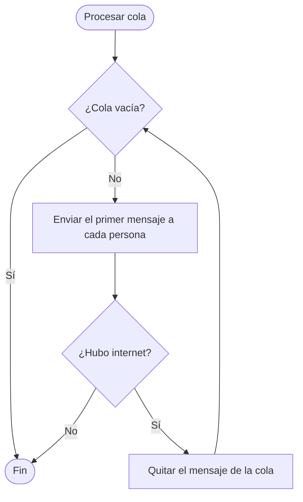

# 6. Avisos por Telegram

## Qué resuelve

Enterarse de un corte aunque no estés frente a la PC. Telegram permite crear un **bot** gratis; el programa le pide al bot que te mande un mensaje.

Problema: durante un corte de internet el mensaje **no puede salir**. Por eso los avisos importantes se guardan en una **cola** y se reintentan cada 30 segundos hasta que vuelva el internet.

| Aviso | ¿Se reintenta? | Por qué |
|---|---|---|
| "Corte en curso" (cuando un corte ya dura 1 minuto) | No | Si no sale ahora, pierde sentido: el aviso de fin lo resume |
| "Volvió la conexión" (fin del corte) | Sí | Es el resumen con duración y diagnóstico |
| "Cambió la IP pública" | Sí | Es una prueba importante |

## Configuración (una sola vez)

1. En Telegram, buscar **BotFather** y escribirle `/newbot`.
2. Ponerle un nombre y un usuario que termine en `bot`.
3. Copiar el código (token) que responde, por ejemplo `1234567890:AAHk3x...`, y pegarlo en **Telegram** dentro de Yedsa.
4. Buscar el bot en Telegram (la lupa) y tocar **INICIAR**.
5. Apretar **Conectar / Agregar persona**.

Para que otra persona también reciba avisos, esa persona busca el bot y toca **INICIAR**; luego se aprieta otra vez **Conectar / Agregar persona**. Yedsa **siempre pregunta** antes de agregar a alguien, porque cualquiera puede encontrar el bot.

## Pseudocódigo

```
Funcion Avisar(texto, conReintento)
    Si no hay bot conectado Entonces Salir
    Si conReintento Entonces
        Agregar texto al final de la cola
        Procesar()
    SiNo
        Enviar(texto)          // si falla, se descarta
    FinSi
FinFuncion

Funcion Procesar()           // también se llama cada 30 segundos
    Mientras la cola no esté vacía Hacer
        resultado <- Enviar(primer mensaje de la cola)
        Si resultado = "sin internet" Entonces
            Salir              // se reintenta más tarde
        FinSi
        Quitar el primer mensaje de la cola     // enviado, o Telegram lo rechazó
    FinMientras
FinFuncion
```

## Diagrama de flujo



## Código

`src/Telegram.cs`:

```csharp
public static async void Procesar()
{
    if (enviando || !Activo) return;
    enviando = true;
    try
    {
        while (pendientes.Count > 0)
        {
            bool? r = await Enviar(pendientes.Peek());
            if (r == null) break;          // sin internet: se reintenta más tarde
            pendientes.Dequeue();          // enviado, o Telegram lo rechazó (no se reintenta)
        }
    }
    finally { enviando = false; }
}
```

`Enviar` devuelve `bool?`: `true` = enviado, `false` = Telegram lo rechazó, `null` = no hubo conexión. Así se distingue "reintentar" de "descartar".

La API de Telegram es una URL: `https://api.telegram.org/bot<token>/sendMessage`. Las respuestas vienen en JSON y se leen con `JavaScriptSerializer`, que viene con .NET Framework.
