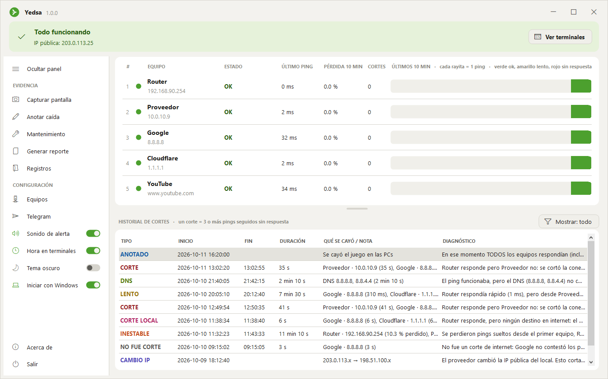

# 7. Interfaz, colores y logo

Todo lo visual está en `src/Interfaz/`. Se usa solo Windows Forms (viene con Windows): ningún control trae esquinas redondeadas ni tema oscuro, así que se **dibujan a mano** con GDI+ (`System.Drawing`).

## Paleta de colores

<p align="center">
  
  
</p>

El tema se elige con el interruptor **Tema oscuro** del panel (se guarda en `ajustes.txt` como `tema=oscuro` o `tema=claro`). Por defecto es oscuro. Los valores están en `Tema.Aplicar()` (`src/Interfaz/Tema.cs`).

| Nombre | Uso | Oscuro | Claro |
|---|---|---|---|
| `Fondo` | Fondo de la ventana | `#0E0E0D` | `#F3F2EE` |
| `Superficie` | Tarjetas y panel lateral | `#171716` | `#FFFFFF` |
| `Superficie2` | Botones, barras de 10 min | `#21211F` | `#F0EFEA` |
| `Hover` | Fondo al pasar el mouse | `#2E2E2B` | `#E4E3DD` |
| `Borde` | Líneas y contornos | `#343431` | `#D6D4CD` |
| `Texto` | Texto principal | `#ECEBE6` | `#1E1E1C` |
| `TextoSec` | Texto secundario; historial: no fue corte | `#A6A49D` | `#5C5B57` |
| `TextoTenue` | Títulos chicos, IPs | `#76756F` | `#888780` |
| `Verde` | OK, interruptores, ícono activo | `#63BA48` | `#4CA02E` |
| `VerdeFondo` / `VerdeTexto` | Franja "Todo funcionando" | `#192D13` / `#ACDC82` | `#E6F2DA` / `#275C0E` |
| `Rojo` | Sin respuesta; historial: hora de la PC mal | `#E24B4A` | `#D63C3A` |
| `RojoFondo` / `RojoTexto` | Franja "Corte en curso"; botones de cerrar | `#4A1616` / `#FAAAA8` | `#FCE8E7` / `#962424` |
| `CerrarHover` | La × de la ventana y los botones de cerrar con el mouse encima | `#C42B1C` | `#C42B1C` |
| `Amarillo` | Ping lento o perdiendo pings; historial: sin respuesta | `#EF9F27` | `#BA7517` |
| `Naranja` | Historial: red inestable | `#F28254` | `#C44E1C` |
| `Rosa` | Historial: corte del local | `#F080AA` | `#B22C68` |
| `Cian` | Historial y franja: mantenimiento | `#5EC4CC` | `#127882` |
| `Lima` | Historial: falla de DNS | `#A6CE4A` | `#547A0A` |
| `Dorado` | Historial: internet lento | `#DEC05C` | `#967000` |
| `Morado` | Historial: cambio de IP | `#B4ACF2` | `#534AB7` |
| `Azul` | Historial: caída anotada | `#87B9EC` | `#185FA5` |

Las **terminales** son negras en los dos temas, para que se vean como el CMD de Windows en las capturas: fondo `#0C0C0C`, texto `#CCCCCC`.

Regla usada: el texto sobre un fondo de color usa el mismo color en versión oscura (en tema claro) o clara (en tema oscuro). Por ejemplo, la franja verde usa `VerdeFondo` con `VerdeTexto`, nunca negro o blanco.

## Fuentes e íconos

- Texto: **Segoe UI** (la de Windows).
- Íconos: **Segoe MDL2 Assets**, una fuente de íconos que trae Windows 10. Cada ícono es un carácter; en el código se escribe como `""` (cámara), `""` (lápiz), etc.
- Terminales: **Consolas**.

## Esquinas redondeadas

`Tema.Redondeado()` arma un rectángulo con 4 arcos en las esquinas y `Tema.Rellenar()` lo pinta con suavizado (`SmoothingMode.AntiAlias`):

```csharp
public static GraphicsPath Redondeado(RectangleF r, float radio)
{
    var p = new GraphicsPath();
    float d = Math.Min(radio * 2, Math.Min(r.Width, r.Height));
    p.AddArc(r.X, r.Y, d, d, 180, 90);                  // arriba a la izquierda
    p.AddArc(r.Right - d, r.Y, d, d, 270, 90);          // arriba a la derecha
    p.AddArc(r.Right - d, r.Bottom - d, d, d, 0, 90);   // abajo a la derecha
    p.AddArc(r.X, r.Bottom - d, d, d, 90, 90);          // abajo a la izquierda
    p.CloseFigure();
    return p;
}
```

Con eso se dibujan `BotonPlano`, `Tarjeta`, la franja de estado (`Banner`) y las barras de 10 minutos.

## Ventana sin la barra de Windows

`FormSinBorde` (`src/Interfaz/VentanaSinBorde.cs`) quita la barra de Windows (`FormBorderStyle.None`) y la reemplaza por `BarraTitulo`, que dibuja el logo, el nombre y los botones —, □ y ×.

- **Mover:** al presionar sobre la barra se le dice a Windows "están agarrando la barra de título" (`WM_NCLBUTTONDOWN` con `HTCAPTION`), y Windows mueve la ventana.
- **Redimensionar:** la ventana deja un borde de 8 píxeles. Cuando Windows pregunta qué hay bajo el mouse (`WM_NCHITTEST`), se responde "borde izquierdo", "esquina inferior derecha", etc.
- **Maximizar sin tapar la barra de tareas:** `MaximizedBounds` = área de trabajo de la pantalla.
- **Jalar la barra estando maximizada:** la ventana vuelve a su tamaño normal y queda pegada al mouse, en la misma proporción en que se agarró la barra (como en Windows).

## Equipos e historial

Entre la tarjeta de equipos y el historial hay un `DivisorArrastrable`, un divisor propio: mientras se arrastra, la tarjeta cambia de alto en vivo y al soltarlo se ajusta a filas completas. Cuántas filas se ven se guarda en `ajustes.txt` (`filas_equipos`). La primera vez se muestran hasta 6 equipos; si hay más (máximo 30), la lista se desplaza con `BarraDesplazamiento`, una barra propia delgada y redondeada, porque la barra de Windows no se puede pintar con el tema. La fila de títulos de las columnas queda fija arriba.

Sobre el historial, el botón **Mostrar** abre un menú para ocultar tipos de fila (ver [Registros](04-registros.md)). Windows dibuja la marca de los menús en negro, que no se ve en el tema oscuro, así que `MenuConTema` dibuja un ✓ verde.

## Panel lateral

`PanelLateral` acomoda sus opciones de arriba hacia abajo y deja **Salir** al fondo. Se pliega a 52 píxeles (solo íconos) y recuerda el estado en `ajustes.txt`.

## Cerrar en rojo

Lo que cierra el programa se marca en rojo, como la × de Windows, para que no se toque sin querer:

- **Salir** del panel (`ItemLateral.Peligro`): con el mouse encima se pone con fondo rojo.
- El botón **Cerrar Yedsa** de la pregunta (`BotonPlano.Peligro`): rojo suave, y rojo fuerte con texto blanco al pasar el mouse. El foco queda en **Cancelar**, para que un Enter sin querer no lo cierre.
- **Salir** en el menú del ícono junto al reloj: con el texto en rojo.

## Casillas

Las casillas de Windows se ven blancas en el tema oscuro. `Casilla` (`src/Interfaz/Controles.cs`) es una propia: un cuadrito redondeado que se pone verde con un ✓ al marcarlo. Se usa en la ventana de **Generar reporte**.

La opción **Mantenimiento** es distinta: su ícono queda en verde todo el rato que dura el mantenimiento y su texto muestra la hora de fin.

Cada opción que hace algo (Capturar, Anotar, Reporte, Registros, Equipos, Telegram) pone su ícono en **verde** mientras trabaja:

```
Funcion Activar(opcion, accion)
    opcion.activo <- Verdadero
    inicio <- ahora
    Ejecutar accion                  // si abre una ventanita, espera a que se cierre
    Si pasaron menos de 0.5 s Entonces
        Esperar lo que falta para 0.5 s
    FinSi
    opcion.activo <- Falso
FinFuncion
```

## Logo

El logo original está en `recursos/yedsa-logo.svg`. Su trazo (sin el cuadrado negro de fondo) está copiado en `src/Interfaz/Logo.cs`, y el programa lo convierte en una figura de GDI+ leyendo los comandos del SVG: `M` (mover), `l` (línea), `c` (curva de Bézier) y `z` (cerrar). Así se dibuja nítido en cualquier tamaño: un círculo verde (rojo durante un corte) con el símbolo blanco adentro.

El ícono del `.exe` (`recursos/yedsa.ico`) se genera con `herramientas/generar-icono.ps1`, que usa ese mismo `Logo.cs`. Solo hace falta correrlo si cambia el logo.
